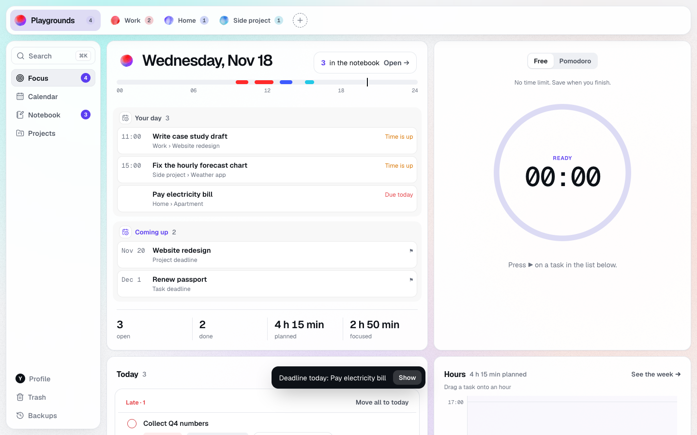
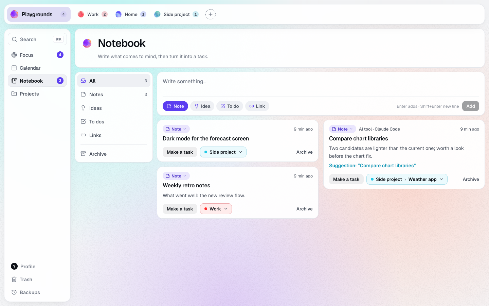

# Playgrounds

A local-first planner you share with your AI tools.

Worlds, projects, tasks, a calendar, a focus timer, a notebook and a social post pipeline, all in one JSON file on your computer. The app shows it; the `pg` command and any AI coding tool (Claude Code, Codex, Cursor, Gemini CLI, …) can read and write it. When a tool adds a task, it appears in the open app within a second, signed with the tool's name. Rou, the assistant inside the app, runs on the LLM command line tool you already use.



## Run it

You need Node.js 20.11 or newer.

```bash
git clone https://github.com/hsynozdamar-byte/open-playgrounds.git
```

```bash
cd open-playgrounds && npm install
```

```bash
npm run dev
```

Open http://localhost:5340. Start with the example world or create your own.

`npm start` builds the app and serves it with a small Node server on the same port (no dev tooling). Both listen on 127.0.0.1 only.

## Pages

- **Focus** (home): today's list grouped by who does it (you or Rou), the timer, an hour timeline, the week, late work, deadlines and outputs waiting for you.
- **Calendar**: drag tasks into hours, see the week, read the week review.
- **Notebook**: quick notes, ideas and suggestions from your tools; one click turns an item into a task. The **Incoming** tab lists inbox sources (Gmail, Slack, Google Calendar, ClickUp); reading them is not built yet.
- **Projects**: tasks, a board, project notes Rou reads before it writes, a media folder, brand fields and the project's automations.
- **Posts**: this and next week's posts by state (awaiting your approval, to prepare, shared), the weekly plan, post ideas and your accounts.
- **Browser** (desktop app only): one browser session per world, side by side.
- **Profile**: focus stats, streaks, accounts and **Settings** (pomodoro, notifications, export, backups, Trash, the assistant).

Worlds are the areas of your life (Work, Home, a side project). Each has its own color; the logo shows them all. Quick add understands plain text: `Call the bank tomorrow 14:00 30m @home #paperwork`. Search with ⌘K or `/`. Deletes stay in the Trash for 30 days; the data file is backed up once a day.

## Rou, the in-app assistant

Rou answers questions about your plan, proposes changes as cards you approve (add a task, move it, schedule it, file a note), prepares outputs for tasks and automations, and answers in the language you write in. It runs your own LLM CLI with your own subscription; no API key is stored.

Set it up:

1. Install one CLI and sign in:
   - Claude Code: `npm i -g @anthropic-ai/claude-code`, then run `claude` once and sign in.
   - Codex: `npm i -g @openai/codex`, then `codex login`.
   - Gemini CLI: `npm i -g @google/gemini-cli`, then run `gemini` once and sign in.
2. Pick it in **Profile › Settings › Assistant**. The status says Ready when the command is on your PATH and signed in.

Only Claude Code can use tools, so reading images and files, web search, work in a browser, live steps and Rou's code changes need it. With another CLI those jobs stop with a message that says so; chat, drafts, topic planning and post writing work. Everything Rou answers from (your tasks, notes, project notes) is sent to the provider of the command you chose.

## Automations and posts

- An **automation** belongs to a project: on its days and times it opens a task (e.g. "LinkedIn post, weekdays 09:00"). Rou prepares it ahead of time, or you do it yourself.
- A **post** is a task tied to a platform or account. Rou writes the text in the account's language (English by default; Turkish and Turkish + English are options), renders carousel images or a short video when the format needs them, checks the result and puts it under **Awaiting your approval**.
- You approve, edit or send a revision note. Rou reads the note, redoes only what you asked and lists what it could not do.
- **Sharing is manual by default.** Press **Share now**, or share it yourself and press **I shared it**. Turn on **Auto-share** on an automation to have Rou share each approved post at its time, in the desktop app's browser session where you are signed in to that account. When Rou cannot share, the text and media are left in a folder for you.

Video and image rendering uses [Remotion](https://www.remotion.dev) (`npm install` inside `render/`). Remotion's license requires a paid company license for some organisations; check https://www.remotion.dev/license before you use it at work.

## Use it with your AI tools

Open the folder in your tool and ask, for example:

> Read AGENTS.md, then run `npm run pg -- list` and tell me what is on my plate today.



`AGENTS.md` tells the tool how to work here: plan through `pg`, sign what it writes, put its own ideas in the Notebook, and do the tasks you hand it with its own tools. `CLAUDE.md` points Claude Code to the same file.

Some things to ask:

- "Plan my week from these notes" (paste them).
- "Break the website project into tasks with estimates."
- "Do my 'Check Instagram messages' task."
- "Block two hours tomorrow morning for the report."

## The `pg` command

```bash
npm run pg -- help
```

Or install it on your PATH with `npm link`, then:

```bash
pg add "Write the about page" --pg work --project Website --day tomorrow --at 10:00 --min 45 --by "Claude Code"
pg in "Read the new API docs" --pg work --url https://example.com/docs --suggest "Read API docs" --by "Codex"
pg list --week
pg notes
```

Days: `today`, `tomorrow`, `someday`, `mon`…`sun`, or `YYYY-MM-DD`.

## Desktop app (macOS and Windows)

The desktop app (Electron) shows Playgrounds in its own window, starts its own server on Electron's built-in Node (no separate Node install needed to run it), and adds the **Browser** page: one signed-in session per world, where Rou works in its own labelled tab while you watch.

Build an installer on your own machine:

```bash
npm run dist:mac   # dist-electron/Playgrounds-<version>-<arch>.dmg
npm run dist:win   # dist-electron/Playgrounds-Setup-<version>.exe (NSIS, Desktop and Start Menu shortcut)
```

- **macOS**: open the dmg and drag Playgrounds to Applications. Without a signing identity the app is ad-hoc signed, so the first launch needs right-click › Open (or `xattr -dr com.apple.quarantine /Applications/Playgrounds.app`). Set `CSC_NAME` (or `CSC_LINK`) to sign with your own Developer ID.
- **Windows**: run the setup exe; it installs per user and adds the shortcuts. The installer is unsigned, so SmartScreen asks once (More info › Run anyway). The installer can be built on a Mac. Windows support has not been tested on a real Windows machine yet; reports are welcome.
- The app uses port 5340 when it is free. If another server already runs there it uses it only when it is the same install (or the same data folder); otherwise it picks a free port and remembers it.
- Start at login stays off until you turn it on in the app menu.
- What the app runs has to be on your PATH: your LLM CLI, `ffmpeg`/`ffprobe` for media, optionally `whisper-cli` for voice. `PG_FFMPEG`, `PG_FFPROBE`, `PG_WHISPER`, `PG_WHISPER_MODEL` and `PG_CHROME` (headless shell) take full paths instead.
- On Windows a few macOS-only extras are hidden or skipped: bringing Google Chrome to the front and the AppleScript notification fallback. Handed-off share folders go to the Recycle Bin. Rendering (`render/`) needs `npm install` in a checkout and is not part of the installer.

From a checkout, `npm run desktop` opens the same app on the repo (it builds `dist/` when the sources are newer and uses `data/`). `browser/build.sh` (macOS) installs a bundle that runs the checkout directly, for working on the app itself.

## Data

| Running from | Data folder | Log |
|---|---|---|
| A checkout (`npm run dev`, `npm start`, `npm run desktop`) | `data/` in the repo | the terminal |
| Desktop app on macOS | `~/Library/Application Support/Playgrounds/data` | `~/Library/Logs/Playgrounds/Playgrounds.log` |
| Desktop app on Windows | `%APPDATA%\Playgrounds\data` | `%APPDATA%\Playgrounds\logs` |

Everything is in `playground.json` in that folder, with daily backups in `backups/`. The app watches the file, so a write from `pg`, a script or a tool shows up at once; a save from the app never overwrites a newer write from elsewhere. Posts left for you to share and the output of browser jobs go to `~/Documents/Playgrounds`.

## Environment variables

| Variable | Meaning |
|---|---|
| `PG_DATA` | data folder for the server and `pg`; use a scratch folder to try things: `PG_DATA=/tmp/pg-try npm run dev` |
| `PG_LLM_CMD` | Rou's command, overrides the setting, e.g. `codex`, `npx @anthropic-ai/claude-code`, `ollama run llama3` |
| `PG_LLM_KIND` | `claude`, `codex`, `gemini` or `text` (any command that reads a prompt on stdin and prints text); guessed from the command |
| `PG_LLM_ARGS` | extra flags for every call, as a JSON array |
| `PG_LLM_PROMPT` | `stdin` (default) or `arg` |
| `PG_MODEL`, `PG_MODEL_MID`, `PG_MODEL_FAST` | models for the strong, middle and fast tier (Claude: `opus`, `sonnet`, `haiku`) |
| `PG_WORK_DIR` | folder for browser job output (default `~/Documents/Playgrounds`) |
| `PG_SHARE_DIR` | folder for posts left for you to share (default `~/Documents/Playgrounds/To share`) |
| `PG_LISTEN` | address to listen on (default `127.0.0.1`) |
| `PG_ALLOW_TAILSCALE` | `1` lets Tailscale addresses and `*.ts.net` names in |
| `PG_CHANGE` | `1` lets Rou change this app's code after your approval (for developers; it runs the tests and the build, then commits locally) |

## Phone access (opt-in)

There is no login. By default the server answers only this computer and refuses requests from other websites. To open it from your phone over Tailscale, start it with:

```bash
PG_LISTEN=0.0.0.0 PG_ALLOW_TAILSCALE=1 npm start
```

Anyone on your tailnet can then read and change your data. Add the page to your home screen to use it like an app.

## Develop

```bash
npm test
```

```bash
npm run build
```

Code map: `src/` is the React app (`views/` pages, `ui/` components, `types.ts` the data model), `server/` the file store, API, scheduler and Rou's jobs, `shared/` logic used by both the app and `pg`, `scripts/pg.mjs` the CLI, `browser/` the desktop shell, `render/` the Remotion compositions, `tests/` vitest.

## License

MIT
